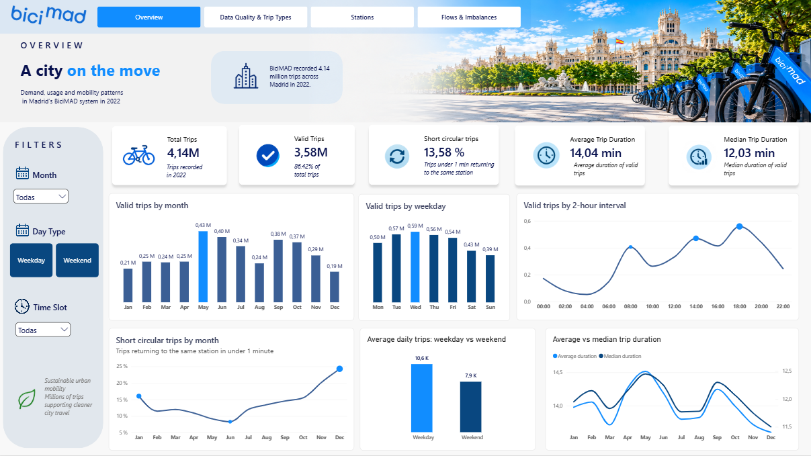
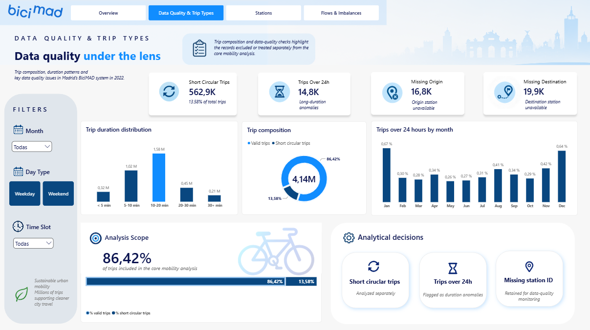
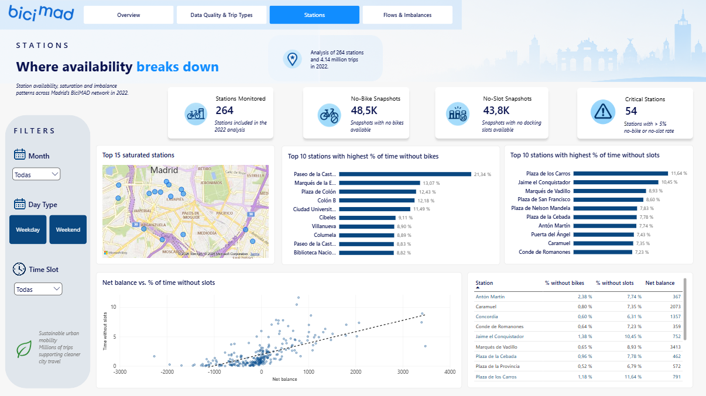
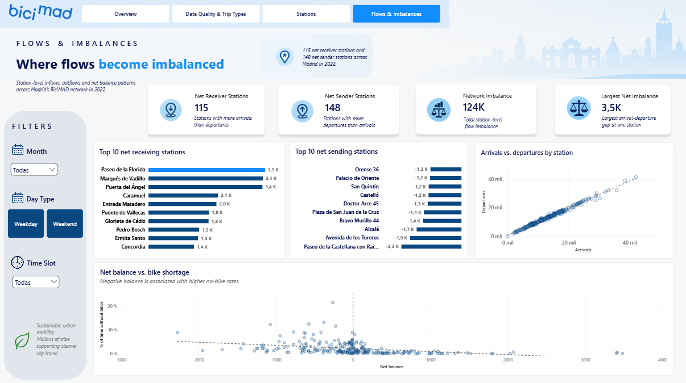

# BiciMAD 2022 — SQL & Power BI Analysis

## Project Overview

This project analyzes Madrid's **BiciMAD bike-sharing system during 2022** using **SQL Server** and **Power BI**.

The goal was to transform raw trip and station-status data into a structured analytical model to understand:

- **When** demand is highest
- **Where** bike and docking-slot shortages occur
- **How** station-level flow imbalances relate to operational pressure

The project covers the full analytical workflow:

**Raw data → Data quality → SQL transformations → Data model → DAX → Power BI dashboard → Operational insights**

---

## Dashboard

### 1. Overview



The Overview page provides a high-level view of BiciMAD usage during 2022.

#### Key KPIs

- **4.14M total trips**
- **3.58M valid trips**
- **13.58% short circular trips**
- **14.04 min average trip duration**
- **12.03 min median trip duration**

#### Main patterns

- Weekday demand shows clear commuting peaks around **08:00** and **18:00–20:00**
- Weekend demand is flatter and shifts later in the day
- The **10–20 minute** range contains the largest share of valid trips
- Short circular trips increase noticeably toward the end of the year

---

### 2. Data Quality & Trip Types



This page focuses on trip classification and the main data-quality decisions applied before the core mobility analysis.

#### Key results

- **562.9K short circular trips**
- **14.8K trips over 24 hours**
- **16.8K trips with missing origin station**
- **19.9K trips with missing destination station**
- **86.42% of trips included in the core mobility analysis**

A **short circular trip** was defined as a trip that:

- starts and ends at the **same station**
- has a duration of **at least 0 minutes**
- lasts **less than 1 minute**

These trips were retained in the dataset but analyzed separately from standard mobility activity.

Trips lasting more than 24 hours were flagged as duration anomalies, while trips with missing station identifiers were retained for data-quality monitoring.

---

### 3. Stations



This page analyzes operational availability across **264 BiciMAD stations**.

#### Key results

- **48.5K snapshots with no bikes available**
- **43.8K snapshots with no docking slots available**
- **54 stations** above the selected availability-issue threshold

The analysis shows that operational pressure is concentrated in specific stations rather than evenly distributed across the network.

Some stations repeatedly experience high no-bike rates, while others are more exposed to docking-slot saturation.

---

### 4. Flows & Imbalances



This page examines how trips move between stations and how station-level flow imbalance relates to availability.

#### Key results

- **115 net receiver stations**
- **148 net sender stations**
- **124K total absolute network imbalance**
- **3.5K largest single-station net imbalance**

A station is considered a **net receiver** when arrivals exceed departures, while a **net sender** has more departures than arrivals.

The analysis shows two important associations:

- **Positive net balance → higher no-slot rates**
- **Negative net balance → higher no-bike rates**

This suggests that stations receiving more trips than they send tend to experience docking saturation, while stations sending more trips than they receive are more exposed to bike shortages.

These relationships are **associative rather than causal**.

---

## Tools & Technologies

- **SQL Server / T-SQL** — data cleaning, consolidation, joins and analytical views
- **Power BI** — data modeling, dashboard development and visualization
- **DAX** — KPIs, temporal analysis and station-level measures

---

## Data & Methodology

The analysis combines two main datasets:

- approximately **4.14M BiciMAD trips**
- approximately **2.3M station-status records**
- **8,738 station snapshots**
- **264 stations**

### Main preparation steps

- Monthly data-quality validation
- Annual trip consolidation
- Trip-duration anomaly detection
- Short circular trip classification
- Station identifier normalization
- Integration of trip and station-status data
- Creation of analytical SQL views for Power BI

Short circular trips were retained in the dataset but excluded from the core mobility analysis.

---

## Key Findings

### Demand follows predictable temporal patterns

Weekdays show clear commuting peaks around **08:00** and **18:00–20:00**, while weekend demand is flatter and shifts later in the day.

### Short circular trips represent a significant share of activity

Short circular trips account for **13.58% of total trips**, supporting the decision to analyze them separately from standard mobility activity.

### Station availability problems are localized

Bike and docking-slot shortages repeatedly affect specific stations, indicating **localized operational pressure** rather than a uniform network-wide problem.

### Flow imbalance helps explain availability problems

**Net receiver stations** tend to face greater docking saturation, while **net sender stations** are more exposed to bike shortages.

---

## Recommendations

- Prioritize rebalancing at persistent **negative-balance stations**
- Anticipate saturation at strong **positive-balance stations**
- Concentrate operational resources around **weekday commuting peaks**
- Monitor recurrent **no-bike and no-slot stations**
- Keep **short circular trips** separate from core mobility KPIs
- Combine **station balance, availability and trip volume** when prioritizing rebalancing operations

---

## Final Conclusion

BiciMAD's main operational challenge is not simply demand generation, but **redistributing bikes across space and time**.

Usage follows predictable temporal patterns, while station-level imbalances contribute to recurring shortages of bikes and docking capacity.

**Targeted rebalancing during peak periods and at persistently imbalanced stations could improve service reliability across the network.**

---

## Repository Structure

```text
bicimad-2022-analysis/
│
├── README.md
│
├── sql/
│   ├── 01_data_quality_january.sql
│   ├── 02_data_quality_february.sql
│   ├── ...
│   └── 18_powerbi_views.sql
│
├── powerbi/
│   └── README.md
│
└── images/
    ├── overview.png
    ├── data_quality.png
    ├── stations.png
    └── flows_imbalances.png
```

---

## Skills Demonstrated

**SQL** · **T-SQL** · **Data Cleaning** · **Exploratory Data Analysis** · **Data Modeling** · **DAX** · **Power BI** · **Dashboard Design** · **Data Storytelling**
